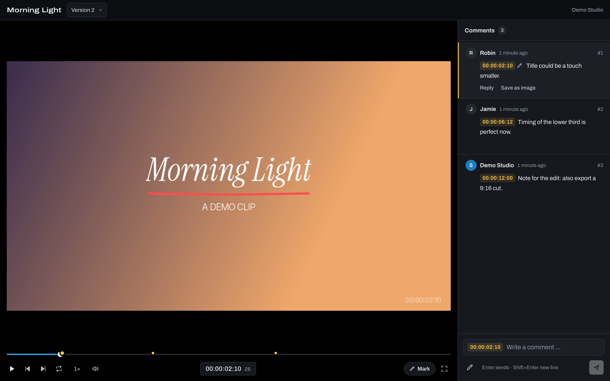
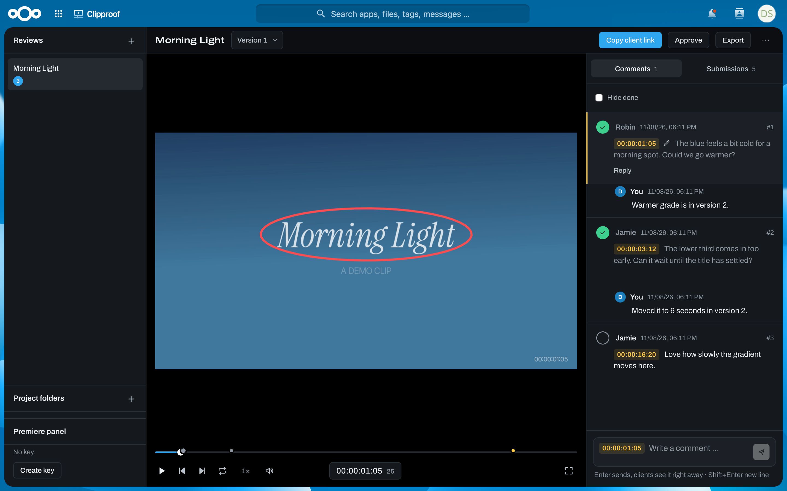
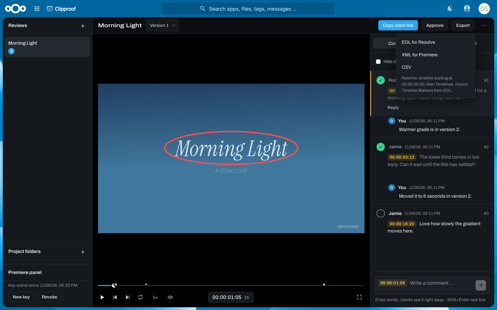
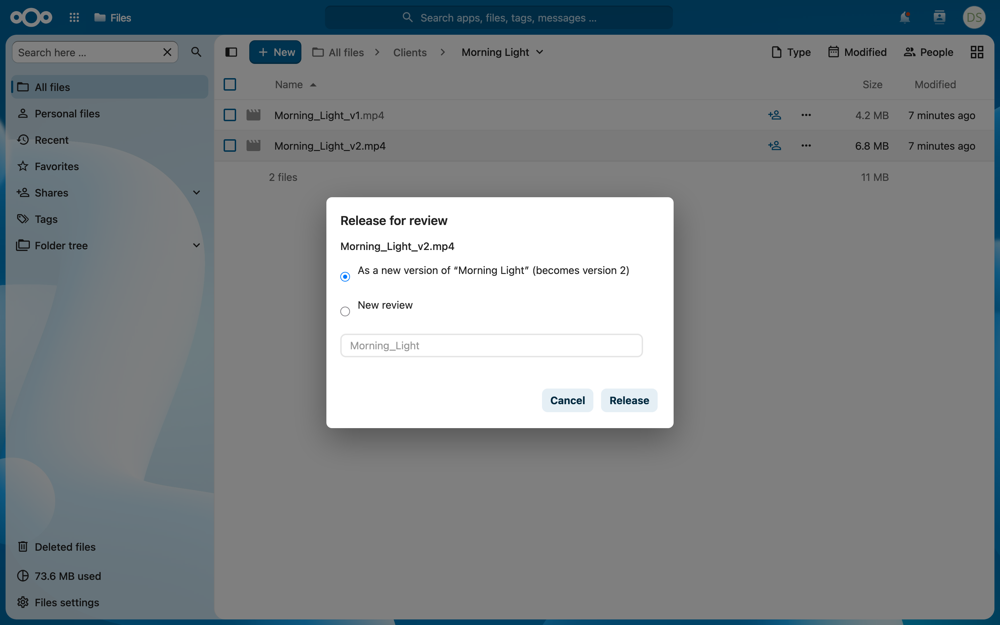
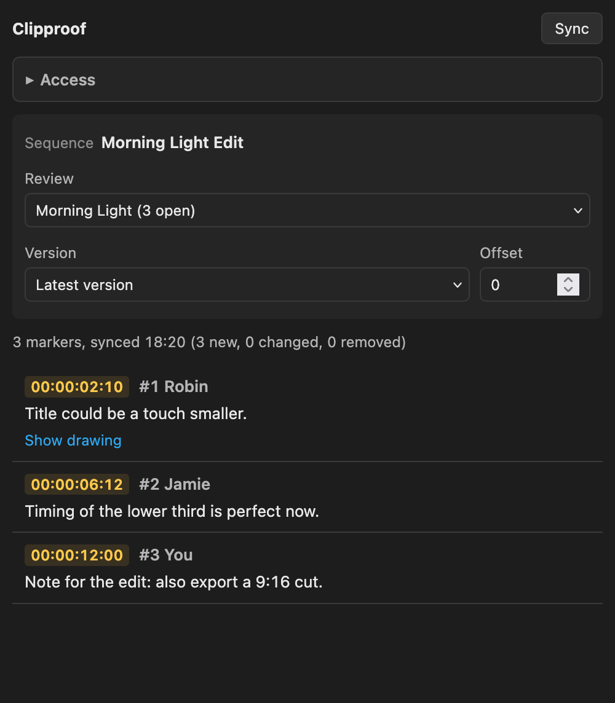
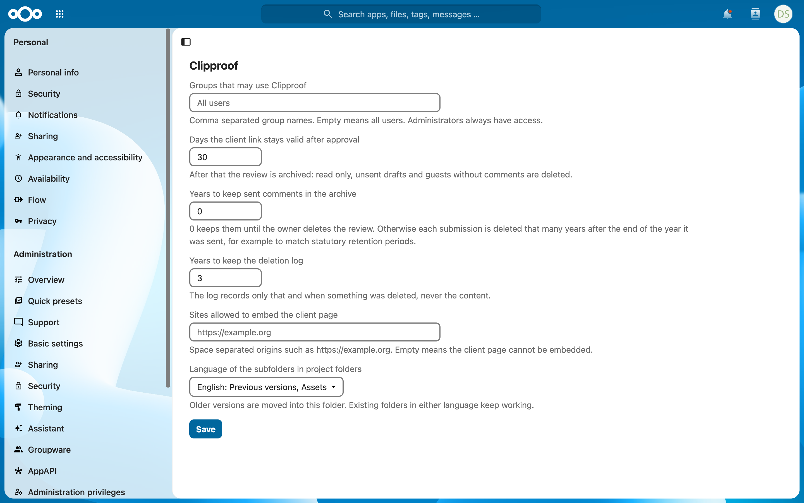

# Clipproof

Frame-accurate video review for Nextcloud. Your clients comment on a video in the browser, on the exact frame, without a Nextcloud account. You import their comments as markers into DaVinci Resolve or Premiere Pro.

**No warranty, maintained when possible.** This app is provided as is (see `LICENSE`). Issues and pull requests are welcome, but there is no guaranteed response time.

## Features

### What your clients see



- Review link per video with its own token, independent of Nextcloud shares.
- Comments on a single frame or a range, with drawings on the frame.
- Each comment is sent with Enter and reaches you right away, as a Nextcloud notification.
- Clients see which comments you have handled and can reply.

### What you see



- All reviews in one place, with versions, replies and a done state per comment.
- Versions: upload a new edit, clients keep the same link.
- Approve a review; the link expires a configurable number of days later and the review moves to a read-only archive.



- Export as EDL (DaVinci Resolve), FCP7 XML and CSV.

### In the Files app



- "Release for review" in the Files app (MP4 and MOV) suggests a new version of a matching review or a new review.
- Optional project folders: the newest video per file name group becomes a review or a new version; older files move to a subfolder, nothing is deleted or overwritten.

### In Premiere Pro



- Optional panel for Premiere Pro that places comments as sequence markers and leaves your own markers alone.
- The panel can be switched between English and German.

### Settings



- English and German (informal `de`, formal `de_DE`, chosen per review).

The screenshots show Clipproof 0.1.0 on Nextcloud 34 with a generated demo clip and made up names. The Premiere Pro panel is shown in a browser with the same demo data, outside Premiere.

## Requirements

- Nextcloud 33 or 34, PHP 8.3 or later.
- Proxies as **H.264 MP4 with constant frame rate**. With a variable frame rate, frame numbers are not reliable, and the app rejects such files.
- No server side transcoding. Frames with drawings are rendered in the browser.
- Bandwidth: one 1080p proxy at 3 to 4 Mbit/s needs that upload rate per viewer.

## Installation

Clipproof is not in the Nextcloud App Store yet. Download the release archive from the
GitHub releases page, extract it into `custom_apps/clipproof` and enable it:

```bash
occ app:enable clipproof
occ clipproof:check
```

`clipproof:check` reads the setup and reports what is missing (cron, `overwrite.cli.url`,
background jobs, tables). It changes nothing.

## Command line

- `occ clipproof:check` checks the setup (read only).
- `occ clipproof:create <user> <path> [--title=...]` creates a review from a video file and prints the client link.
- `occ clipproof:add-version <user> <review-id> <path>` attaches a new cut; the client link stays the same.

## Configuration

*Administration settings → Additional settings → Clipproof*:

- Groups allowed to create reviews (empty means all users).
- Days the link stays valid after approval (default 30).
- Years sent comments stay in the archive (default 0, kept until the owner deletes the review).
- Years the deletion log is kept (default 3).
- Sites allowed to embed the client page (`frame-ancestors`, default none). Only the client page can be embedded.
- Language of the subfolders in project folders: English (`Previous versions`, `Assets`, default) or German (`Vorversionen`, `Assets`). Existing folders in either language keep working.

## Privacy

Clipproof stores the name a client enters and their comments. It sets no cookies of its own and loads nothing from third party servers. Nextcloud itself sets technically necessary cookies. `docs/privacy-template.md` contains a template for your privacy policy in English and German; it is not legal advice.

## Premiere Pro panel

The folder `premiere-panel/` contains a CEP panel. In Clipproof, create a panel key under *Premiere panel*, then enter your Nextcloud address and the key in the panel. The key can only read your own reviews.

## Development

```bash
npm ci
npm run build
npx vitest run --dir tests/js
composer install
vendor/bin/phpunit -c phpunit.xml
vendor/bin/phpcs --standard=phpcs.xml
node tools/l10n.mjs
```

`tools/paket.sh` builds the release archive.

## License

AGPL-3.0-or-later, see `LICENSE`. Third party components: `THIRD-PARTY-NOTICES.md`.

Copyright 2026 Schauties Media

## Trademarks

Adobe Premiere Pro is a trademark of Adobe Inc. DaVinci Resolve is a trademark of Blackmagic Design Pty. Ltd. Nextcloud is a trademark of Nextcloud GmbH. Clipproof is an independent project and is not affiliated with or endorsed by any of them.

## From the same workshop

Clipproof is made by Schauties Media, a small video studio in Hannover.
If you edit short-form videos, you might like **UT16**: it transcribes your clip
with word timestamps, highlights the key words and renders animated 9:16 subtitles
for Reels, TikTok and Shorts as a ProRes overlay, right inside Premiere Pro and
DaVinci Resolve. Have a look: https://stsservice.de/untertitel-studio

## Legal notice

Impressum: https://stsservice.de/impressum
